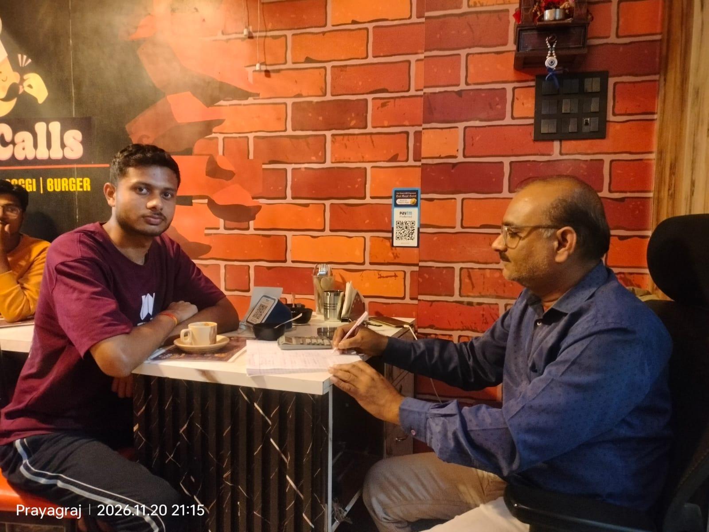

# Fieldwork - FoodCalls, Prayagraj

## Visit

- **Where:** FoodCalls (pizza | burger | chowmein), near IIIT Allahabad, Prayagraj
- **When:** 20 Nov 2026, approx. 20:20 to 21:30
- **Who:** Navesh Gupta, owner <!-- TODO: confirm spelling -->

| Time | Photo |
|---|---|
| 20:20 |  |
| 20:27 |  |
| 21:15 |  |

My handwritten notes from the conversation are in `photos/05` to `photos/09`.

## What I saw (20 min at the place)

<!-- TODO (you): 3-5 lines in your own words. E.g. how many tables were full, did anyone wait
     or leave, what the kitchen looked like, how many staff were working. -->

## Conversation

**Shop facts he gave me**
- 65 items on the menu. 4 staff: 2 chefs, 1 waiter, 1 cleaner.
- Open 10 am to 10 pm. Busiest from 5 to 8 pm, when classes get over.
- About 50-60 regular customers a day. Around 80% are from IIIT Allahabad, 20% from other colleges.
- 18 seats. He wants about 30, but the shop is rented and there is no space.
- Vegetables come from the mandi every day, not from local shops. Everything is paid in cash, nothing on credit (udhaar).

**3 things he said**
1. Boiled noodles and pasta don't last, so whatever is left gets thrown away. Sauces are fine because they have preservatives.
2. The quantity is not fixed. Some days orders go up, some days they go down, so prep is a guess.
3. Prep is done in two parts, and the hard part is the sudden spike at certain times, when students come after class.

**1 thing that surprised me**
<!-- TODO (you): pick the one that actually surprised you, in your own words. Candidates from your notes:
     - he removed items like brownie with ice cream, garlic chilli bread, samosa, paneer cutlet because they did not sell
     - he says he doesn't worry about competition because his quality is good and prices beat the college mess/canteen
     - Domino's charges ~100 for mineral water but he gives water free
     - electricity bill is about 15,000 a month, mostly from the pizza oven -->

## Data (`data.csv`)

<!-- TODO: describe exactly how each row was collected, e.g.
     "Rows marked source=counted: I sat at the corner table on <date> from <time> to <time> and wrote a line every 10 minutes.
      Rows marked source=register: copied from the owner's daily register page (photo: photos/10_register.jpeg).
      Rows marked source=owner_estimate: numbers he told me from memory, not counted." -->
