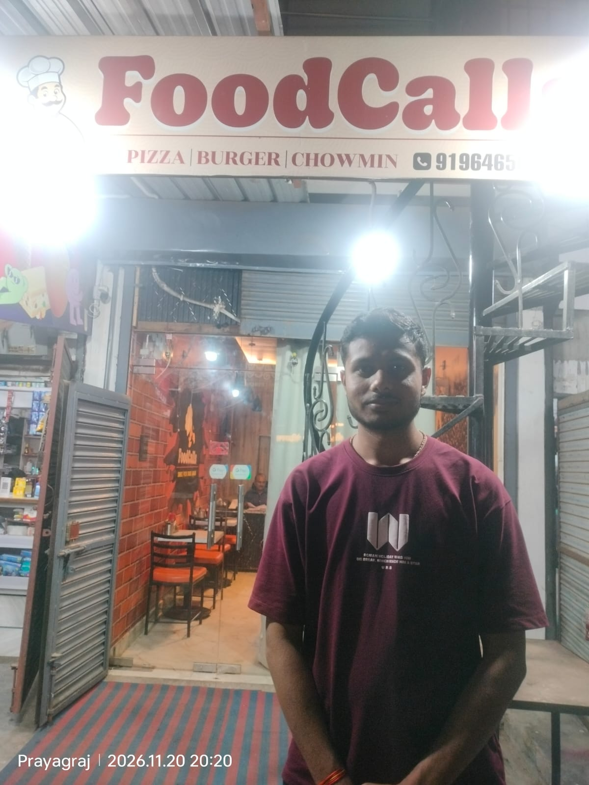

# Fieldwork - FoodCalls, Prayagraj

## Visit

- **Where:** FoodCalls (pizza | burger | chowmein), near IIIT Allahabad, Prayagraj
- **When:** 20 Nov 2026, approx. 20:20 to 21:30
- **Who:** Nivesh Gupta, owner

| Time | Photo |
|---|---|
| 20:20 |  |
| 20:27 |  |
| 21:15 |  |

My handwritten notes from the conversation are in `photos/05` to `photos/09`.

## What I saw (20 min at the place)

- The shop was clean everywhere: tables, counter and the kitchen area I could see.
- The ingredients looked fresh. Vegetables come from the mandi every day, and nothing looked stored for long.
- The staff were polite and quick with customers. 4 people run the whole place (2 chefs, 1 waiter, 1 cleaner).
- The seating area is small, about 18 seats, and the kitchen is tight. He said there is no room for more equipment either.
- The shop is fairly new and most orders are walk-in. He said online orders are still low and getting the business online is important to him now.

## Conversation

**Shop facts he gave me**
- 65 items on the menu. 4 staff: 2 chefs, 1 waiter, 1 cleaner.
- Open 10 am to 10 pm. Busiest from 5 to 8 pm, when classes get over.
- About 50-60 regular customers a day. Around 80% are from IIIT Allahabad, 20% from other colleges.
- 18 seats. He wants about 30, but the shop is rented and there is no space.
- Vegetables come from the mandi every day, not from local shops. Everything is paid in cash, nothing on credit (udhaar).

**3 things he said**
1. Boiled noodles and pasta don't last, so whatever is left gets thrown away. Sauces are fine because they have preservatives.
2. The quantity is not fixed. Some days orders go up, some days they go down, so prep is a guess.
3. Prep is done in two parts, and the hard part is the sudden spike at certain times, when students come after class.

**1 thing that surprised me**

He isn't worried about competition at all. I expected a small new shop near a college to be worried about the mess, the canteen and the other cafes nearby. He said his quality is good and his prices beat the college mess and canteen, so students come back anyway. He also said he is a good cook himself, and that someone who can't cook well shouldn't run this kind of cafe, because you need real interest in the food. I thought a cafe was mainly a business problem (rent, staff, prices), but for him it starts with being able to cook.

## Data (`data.csv`)

**These numbers are an estimate. They were not counted plate by plate.** Every row has `source=estimate`.

How I built them:
- **From Nivesh ji (what he told me on 20 Nov):** about 50-60 customers a day, and about 20 of them order noodles, Maggi or pasta. The rush is 5-8 pm, and the shop is open 10 am to 10 pm.
- **From me:** I split those ~20 plates a day into noodles (the bigger share) and pasta, across 3 slots (10-17, 17-20, 20-22), putting about half in the 5-8 pm rush. I varied the totals a little from day to day (19-24 plates) because he said "quantity is not fixed". The dates are the 5 weekdays up to my visit (16-20 Nov), 30 rows in total.
- **Left blank on purpose:** `boiled_plates` and `thrown_plates`. He told me he throws boiled noodles/pasta away but didn't give amounts, and I didn't want to invent them.

What would make it real: Nivesh ji (or his chef) writes 3 numbers per slot for a week (plates boiled, sold, thrown) in his register. The same script then also shows how much waste the suggestion would save.
